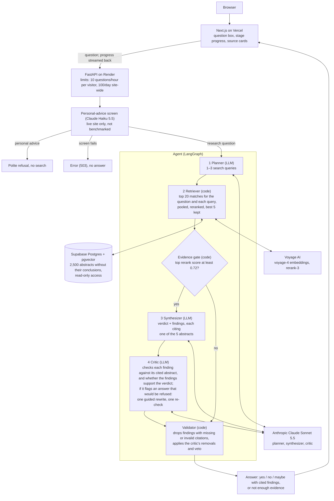

# GroundedMed

**Agentic Biomedical Research Analyst — evidence-grounded RAG with citation verification and reproducible evaluation**

**Live demo: https://groundedmed.vercel.app** · Research demonstration only, not medical advice.

Ask Becky, the site's assistant, a research question. An agentic RAG pipeline (planner, retriever, answer writer and
critic) finds the relevant medical research abstracts and answers yes / no / maybe, with every finding citing the
abstract it is based on. Code checks every citation, and the critic checks each finding against the abstract it
cites. When the critic flags an answer that would otherwise be refused, the writer gets one guided rewrite and the
critic checks it once more. When the evidence can't back an answer up, it says "not enough evidence". It runs live
(Next.js on Vercel, FastAPI on Render) and was evaluated on two hash-locked PubMedQA test sets, the second a fresh set
of 400 questions whose decision rules were written down before it ran.


*Recorded on the live site, November 2026. The wait for the first answer plays at 3× speed, as the badge in the recording shows.*

## How it works



- **Planner** turns the question into 1–3 search queries.
- **Retriever** searches 2,500 abstracts by meaning, reranks the best matches, and keeps the top 5. If even the best
  match is weak, the system says "not enough evidence" instead of answering.
- **Synthesizer** writes a yes / no / maybe verdict as short findings, each citing one of the 5 abstracts.
- **Critic** checks each finding against the abstract it cites, and can remove findings or reject the whole answer,
  but never add anything. When it flags an answer that would otherwise be refused, the synthesizer writes one new
  answer from the same 5 abstracts with the critic's notes, and the critic checks that once; the rewrite passes the
  same checks as any answer, and there is never a second one.
- **Validator** (plain code, no AI) drops any finding whose citation is missing or not one of the 5 abstracts.

## Tech stack

- Python 3.12, FastAPI, LangGraph
- Anthropic Claude Sonnet 5.5 (answers), Claude Haiku 5.5 (personal-advice screen)
- Voyage AI embeddings and reranking
- PostgreSQL with pgvector (Supabase)
- Next.js, React, TypeScript (plain CSS)
- Google Gemini (offline evaluation judge only)
- pytest, Playwright, GitHub Actions, uv, ruff
- Vercel (frontend), Render (API)

## Key engineering decisions

- **Refusals count as wrong.** Accuracy is out of all the test questions, so the system can't look better just by
  refusing hard ones.
- **The critic doesn't grade itself.** The agent's critic (Anthropic) is never the judge of the results; an AI from
  a different company (Google) judged the v1.0.0 results offline, blinded to which system wrote what.
- **Citations are checked by code.** A finding reaches the screen only if its citation points to one of the
  abstracts actually retrieved for that question. Whether the abstract really supports it is checked by AI, not code.
- **No answers in the search index.** Only each abstract's text without its conclusion is searchable; the answer
  labels and conclusions are never stored where the system can see them, and tests check this.

## How it's evaluated

- **Locked test sets, each run once.** 200 test questions were locked by a hash before any system was built. Later,
  a fresh set of 400 was locked the same way from questions nobody had looked at, before any tuning. Each system ran
  once on each set (baseline and agent; the closed-book control on the first), and everything tuned was tuned on 100
  separate dev questions.
- **Rules before results.** The decision rules for the 400-question test were written down and coded into its scorer
  before it ran, and code blocks a second run on a locked set unless it is overridden with a recorded reason (never
  used).
- **Refusals count as wrong**, and the scorer refuses result files that don't cover the same questions.
- **Paired statistics.** Wilson 95% ranges for each system; for differences, a paired bootstrap over the same
  questions (2,000 resamples) and an exact sign test.
- **Independent judge (v1.0.0).** An AI from a different company (Google Gemini), never the system's own critic,
  rated whether each finding is fully supported by the abstract it cites, blinded to which system wrote it; a
  second-AI cross-check (ChatGPT) re-labelled a sample of its labels.

## Results

Every number below is read from the stored result files in `eval/results/`; the live dashboard shows them with their
ranges: https://groundedmed.vercel.app/eval

**Latest test (v1.1.0): 400 fresh questions**

| | Baseline | Agent |
|---|---|---|
| Correct answers, refusals counted as wrong | 76.5% (306/400), 95% range 72.1–80.4% | 76.0% (304/400), 95% range 71.6–79.9% |
| Refused ("not enough evidence") | 16 | 18 |
| Right abstract ranked 1st / in top 5 | 98.0% / 99.5% | 98.0% / 99.5% |
| Typical time per answer (median) | 4.67 s | 12.58 s |
| AI cost per question (mean) | $0.0131 | $0.0304 |

The guided rewrite ran on 11 of the 400 questions, all of which would otherwise have been refused; 7 of the 11 ended
with the right answer. Agent and baseline were statistically tied: paired difference −0.5 points (95% range −2.75 to
+1.75), exact sign test p = 0.81.

<details>
<summary><b>First test (v1.0.0): 200 questions</b></summary>

<br>

The agent as it was at v1.0.0, with a closed-book control and the independent judge.

| | Closed-book (no retrieval) | Baseline | Agent |
|---|---|---|---|
| Correct answers, refusals counted as wrong | 54.0% (108/200) | 76.5% (153/200) | 74.0% (148/200) |
| Questions answered (not refused) | 100.0% (200/200) | 97.5% (195/200) | 95.0% (190/200) |
| Correct, of the questions answered | 54.0% (108/200) | 78.5% (153/195) | 77.9% (148/190) |
| Right abstract ranked 1st / in top 5 | — | 98.5% / 100.0% | 98.5% / 100.0% |
| Findings fully supported by their cited abstract (AI-judged)* | — | 93.2% (455/488) | 95.0% (421/443) |
| Limitations fully supported by their cited abstract (AI-judged)** | — | 86.2% (344/399) | 91.3% (306/335) |
| Typical time per answer (median) | 1.00 s | 4.23 s | 11.79 s |
| AI cost per question, refusals included (mean) | $0.0011 | $0.0131 | $0.0287 |

Retrieval is what makes the answers good: it adds 22.5 points of accuracy over the same AI with no abstracts (95%
range +15.0 to +29.5; closed-book scored 54.0%, no better than always answering "yes" at 55.0%). The agent's critic
adds a second layer of checking: the independent judge rated its limitations fully supported more often (91.3% vs
86.2%, +5.1 points, paired 95% range +1.8 to +8.6).

Closed-book is the same AI answering from the question alone, with no abstracts, so it has nothing to cite (—).
\* Judged by an independent AI from a different company (Google Gemini). A second-AI cross-check (ChatGPT)
re-labelled 30 of these findings; no person checked them. \*\* Same judge; limitations were not in the second-AI
cross-check. Cost counts AI model tokens at list price; times are from a laptop, one question at a time.

</details>

## Limitations

- **The benchmark makes search easy.** PubMedQA questions are often the paper's own title, so the right abstract is
  found almost every time (in the top 5 for 100.0% and 99.5% of the two test sets). Real-world search would be harder.
- **"Supported" is judged by AI, on the v1.0.0 test only.** The 400-question test had no judge run. No person checked
  the findings. The judge is one AI model, and the second-AI
  cross-check covered only 30 findings: the second AI agreed with 14 of the 20 findings the judge accepted (6 of 10 for the agent) and
  8 of the 10 it rejected, so the support figures may be optimistic. Limitations were not cross-checked.
- **Two tests, one run each.** 200 and 400 questions, one run per system on each: small differences fall inside the
  ranges on the dashboard.
- **The AI may know the answers.** PubMedQA is public and may be in the model's training data; the closed-book result
  suggests it does not simply remember them.
- **Small, fixed library.** It answers only from 2,500 PubMedQA abstracts, not all of PubMed.
- **Wording matters.** Casually worded or misspelled questions sometimes get "not enough evidence" even when the
  right abstract is in the library.
- **Demo limits reset when the server restarts.** The 10-questions-per-hour and 100-per-day limits are kept in the
  server's memory, so a redeploy, restart or crash starts them again from zero, and the daily count also resets at
  midnight UTC. A monthly spend limit set with the AI provider caps the total cost.
- **Not medical advice.** The live site refuses questions about a person's own health, but that screen is an AI
  check and can make mistakes. It is not part of either test, so the results above do not include it.

## Run it locally

Requires [uv](https://docs.astral.sh/uv/) and Node.js. Run commands from the repo root unless they start with
`cd frontend`.

```bash
uv sync
uv run python -m scripts.prepare_dataset
uv run ruff check .
uv run pytest
```

`prepare_dataset` downloads PubMedQA from Hugging Face (no key needed) and rebuilds the corpus the tests read; tests
that need API keys or the database are skipped when those are not set.

**Try the interface with no API keys.** A fake API answers every question with text labelled MOCK. Install once, then
run each of these in its own terminal:

```bash
cd frontend && npm install
```

```bash
cd frontend && npm run mock-api
```

```bash
cd frontend && NEXT_PUBLIC_API_BASE_URL=http://localhost:8001 npm run dev
```

Then open http://localhost:3000.

**Run the real system.** You need your own Anthropic and Voyage AI API keys and an empty Postgres database with the
pgvector extension available. Copy `.env.example` to `.env` and set `ANTHROPIC_API_KEY`, `VOYAGE_API_KEY` and
`DATABASE_ADMIN_URL` (an admin connection string). Leave `DATABASE_URL` empty: the ingest step creates a read-only
database user and writes `DATABASE_URL` into `.env` for you. Never commit `.env`. Then load the corpus prepared
above and start the API:

```bash
uv run python -m scripts.ingest
```

```bash
uv run uvicorn backend.app.main:app --port 8000
```

In another terminal, start the interface against it and open http://localhost:3000:

```bash
cd frontend && NEXT_PUBLIC_API_BASE_URL=http://localhost:8000 npm run dev
```

## More detail

- [docs/methodology.md](docs/methodology.md): the evaluation method in full, the evaluation diagram, each pipeline
  step and what code enforces
- [ARCHITECTURE.md](ARCHITECTURE.md): the full design
- [docs/operations.md](docs/operations.md): live checks and upkeep for maintainers
