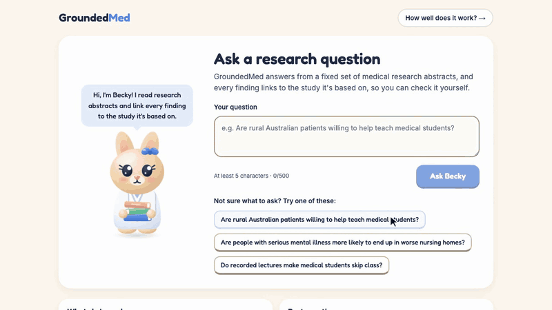
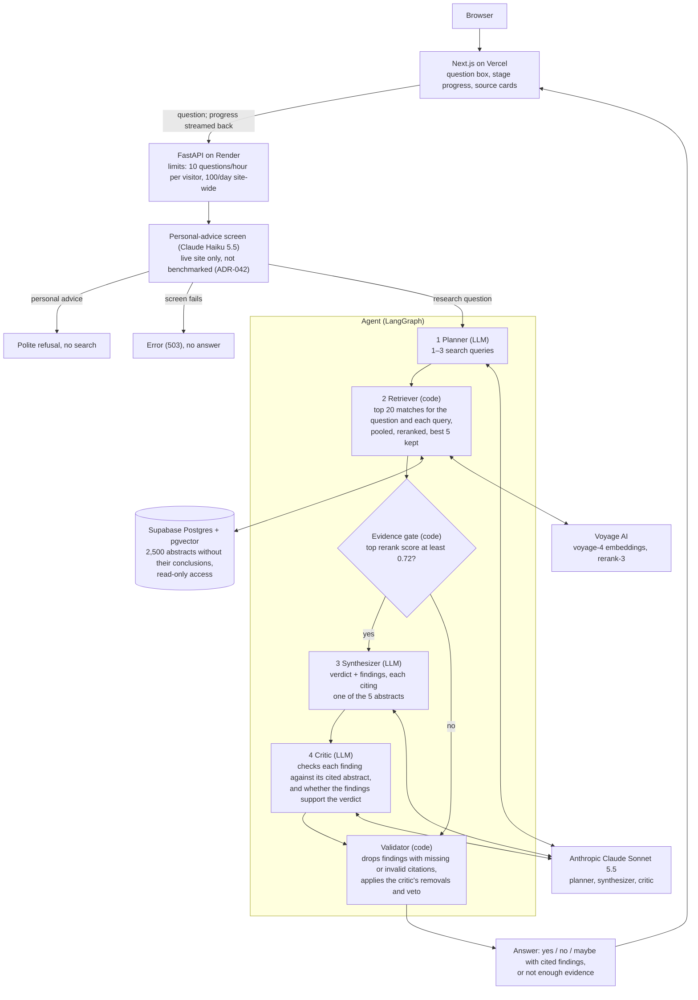

# GroundedMed

**Agentic Biomedical Research Analyst — evidence-grounded RAG with citation verification and reproducible evaluation**

**Live demo: https://groundedmed.vercel.app** · Research demonstration only, not medical advice.

Ask Becky, the site's assistant, a research question: the system finds relevant medical research abstracts, answers
yes / no / maybe with every finding citing the abstract it is based on, and says "not enough evidence" when it can't
back an answer up.



*Recorded on the live site, November 2026. The wait for the first answer plays at 3× speed, as the badge in the recording shows.*

## Results

Tested once on 200 frozen questions from PubMedQA (a public benchmark of yes / no / maybe questions about medical
research papers) that were never used for tuning. Every number below is read
from the stored result files and matches the live dashboard, which also shows 95% ranges:
https://groundedmed.vercel.app/eval

| | Closed-book (no retrieval) | Baseline | Agent | Agent minus baseline (95% range) | Clear difference? |
|---|---|---|---|---|---|
| Correct answers, refusals counted as wrong | 54.0% (108/200) | 76.5% (153/200) | 74.0% (148/200) | −2.5 pts (−5.0 to −0.5) | Yes: agent lower, mainly because it refuses more |
| Questions answered (not refused) | 100.0% (200/200) | 97.5% (195/200) | 95.0% (190/200) | −2.5 pts (−4.5 to −0.5) | Yes: agent refuses more |
| Correct, of the questions answered | 54.0% (108/200) | 78.5% (153/195) | 77.9% (148/190) | −0.6 pts (−2.1 to +0.7) | No: within noise |
| Right abstract ranked 1st / in top 5 | — | 98.5% / 100.0% | 98.5% / 100.0% | none | No: identical |
| Findings fully supported by their cited abstract (AI-judged)* | — | 93.2% (455/488) | 95.0% (421/443) | +1.8 pts (−0.04 to +3.7) | No: within noise |
| Limitations fully supported by their cited abstract (AI-judged)** | — | 86.2% (344/399) | 91.3% (306/335) | +5.1 pts (+1.8 to +8.6) | Yes: agent higher (AI judge only) |
| Typical time per answer (median) | 1.00 s | 4.23 s | 11.79 s | +7.56 s (+7.22 to +7.84) | Yes: agent slower |
| AI cost per question, refusals included (mean) | $0.0011 | $0.0131 | $0.0287 | +$0.0156 (+$0.0151 to +$0.0161) | Yes: agent costs more |

Closed-book is the same AI answering from the question alone, with no abstracts, so it has nothing to cite (—).
"Clear difference" means the 95% range of the paired difference (a bootstrap over the same 200 questions) does not
include zero; each row is its own test. \* Judged by an independent AI from a different company (Google Gemini). A
second-AI cross-check (ChatGPT) re-labelled 30 of these findings; no person checked them. \*\* Same judge; limitations
were not in the second-AI cross-check. Cost counts AI model tokens at list price; times are from a laptop, one
question at a time.

**What this means:** retrieval is what makes the answers good, adding 22.5 points of accuracy over the same AI with
no abstracts (95% range +15.0 to +29.5; closed-book scored 54.0%, no better than always answering "yes" at 55.0%),
while the agent's extra stages add limitations that the AI judge rated better supported, at almost 3 times the time
and about twice the cost of the baseline and with slightly lower overall accuracy, mainly because it refuses more.

## How it works



- **Planner** turns the question into 1–3 search queries.
- **Retriever** searches 2,500 abstracts by meaning, reranks the best matches, and keeps the top 5. If even the best
  match is weak, the system says "not enough evidence" instead of answering.
- **Synthesizer** writes a yes / no / maybe verdict as short findings, each citing one of the 5 abstracts.
- **Critic** checks each finding against the abstract it cites, and can remove findings or reject the whole answer,
  but never add anything.
- **Validator** (plain code, no AI) drops any finding whose citation is missing or not one of the 5 abstracts.

## Tech stack

- Python 3.12, FastAPI, LangGraph
- Anthropic Claude Sonnet 5.5 (answers), Claude Haiku 5.5 (personal-advice screen)
- Voyage AI embeddings and reranking
- PostgreSQL with pgvector (Supabase)
- Next.js, React, TypeScript (plain CSS)
- Google Gemini (offline evaluation judge only)
- pytest, Playwright, GitHub Actions, uv, ruff
- Vercel (frontend), Render (API)

## Key engineering decisions

- **Refusals count as wrong.** Accuracy is out of all 200 questions, and "answered" is always shown next to "correct
  when answered", so the system can't look better just by refusing hard questions.
- **The critic doesn't grade itself.** The agent's critic (Anthropic) is never the judge of the results; an AI from
  a different company (Google) judged them offline, blinded to which system wrote what.
- **Frozen test set.** The 200 test questions were locked by a hash before any system was built, each system ran on
  them exactly once, and everything tuned was tuned on 100 separate questions.
- **Citations are checked by code.** A finding reaches the screen only if its citation points to one of the
  abstracts actually retrieved for that question. Whether the abstract really supports it is checked by AI, not code.
- **No answers in the search index.** Only each abstract's text without its conclusion is searchable; the answer
  labels and conclusions are never stored where the system can see them, and tests check this.

## Limitations

- **The benchmark makes search easy.** PubMedQA questions are often the paper's own title, so the right abstract is
  found almost every time (top 5: 200/200). Real-world search would be harder.
- **"Supported" is judged by AI.** No person checked the findings. The judge is one AI model, and the second-AI
  cross-check covered only 30 findings: the second AI agreed with 14 of the 20 findings the judge accepted (6 of 10 for the agent) and
  8 of the 10 it rejected, so the support figures may be optimistic. Limitations were not cross-checked.
- **Small test, one run.** 200 questions, one run per system: small differences fall inside the ranges on the
  dashboard.
- **The AI may know the answers.** PubMedQA is public and may be in the model's training data; the closed-book result
  suggests it does not simply remember them.
- **Small, fixed library.** It answers only from 2,500 PubMedQA abstracts, not all of PubMed.
- **Wording matters.** Casually worded or misspelled questions sometimes get "not enough evidence" even when the
  right abstract is in the library.
- **Demo limits reset when the server restarts.** The 10-questions-per-hour and 100-per-day limits are kept in the
  server's memory, so a redeploy, restart or crash starts them again from zero, and the daily count also resets at
  midnight UTC. A monthly spend limit set with the AI provider caps the total cost.
- **Not medical advice.** The live site refuses questions about a person's own health, but that screen is an AI
  check and can make mistakes. It was added after the evaluation, so the results above do not include it.

## Run it locally

Requires [uv](https://docs.astral.sh/uv/) and Node.js. Run commands from the repo root unless they start with
`cd frontend`.

```bash
uv sync
uv run python -m scripts.prepare_dataset
uv run ruff check .
uv run pytest
```

`prepare_dataset` downloads PubMedQA from Hugging Face (no key needed) and rebuilds the corpus the tests read; tests
that need API keys or the database are skipped when those are not set.

**Try the interface with no API keys.** A fake API answers every question with text labelled MOCK. Install once, then
run each of these in its own terminal:

```bash
cd frontend && npm install
```

```bash
cd frontend && npm run mock-api
```

```bash
cd frontend && NEXT_PUBLIC_API_BASE_URL=http://localhost:8001 npm run dev
```

Then open http://localhost:3000.

**Run the real system.** You need your own Anthropic and Voyage AI API keys and an empty Postgres database with the
pgvector extension available. Copy `.env.example` to `.env` and set `ANTHROPIC_API_KEY`, `VOYAGE_API_KEY` and
`DATABASE_ADMIN_URL` (an admin connection string). Leave `DATABASE_URL` empty: the ingest step creates a read-only
database user and writes `DATABASE_URL` into `.env` for you. Never commit `.env`. Then load the corpus prepared
above and start the API:

```bash
uv run python -m scripts.ingest
```

```bash
uv run uvicorn backend.app.main:app --port 8000
```

In another terminal, start the interface against it and open http://localhost:3000:

```bash
cd frontend && NEXT_PUBLIC_API_BASE_URL=http://localhost:8000 npm run dev
```

## More detail

- [docs/methodology.md](docs/methodology.md): the evaluation method in full, the evaluation diagram, each pipeline
  step and what code enforces, and references to the recorded design decisions (ADR-nnn)
- [ARCHITECTURE.md](ARCHITECTURE.md): the full design · [DECISIONS.md](DECISIONS.md): every decision and why
- [docs/operations.md](docs/operations.md): live checks and upkeep for maintainers
