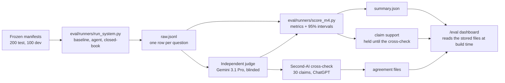

# GroundedMed: methodology and design details

**Agentic Biomedical Research Analyst — evidence-grounded RAG with citation
verification and reproducible evaluation**

Built a four-stage planner → retriever → synthesizer → critic research pipeline over
conclusion-free PubMedQA contexts. The system produces traceable citations, abstains when
evidence is weak, and compares agentic performance against a single-call RAG baseline on a
held-out benchmark.

This page holds the detail behind the README: how each step works, how the evaluation was run, and where every
decision is recorded. Decisions are cited as ADR-nnn and live in [DECISIONS.md](../DECISIONS.md); the full design is in
[ARCHITECTURE.md](../ARCHITECTURE.md). Headline results and plain-English limitations are in the
[README](../README.md); every number, with its 95% range, is on the live dashboard
(https://groundedmed.vercel.app/eval).

## Architecture in detail

The live site runs the **agent**. Its four stages are planner → retriever → synthesizer → critic, with a code
check in between (the evidence gate) and a code validator at the end. The **baseline** it is compared with uses the same
retriever, gate, synthesizer prompt and validator, but has no planner and no critic: it retrieves for the question
alone and makes one model call.

The diagram of a live question is in the README.

How the published numbers are produced (on the developer machine; only the finished result files reach the site):

In the table, **bold** limits are enforced by code; the others are instructions in the prompt (PROMPTS.md) whose
effect the validator, the critic and the offline judge check after the fact.

| Step | Kind | What it does | What it must not do |
|---|---|---|---|
| Planner | LLM | Turns the question into 1–3 search sub-queries | Answer the question or make biomedical claims (code drops a sub-query that starts with a verdict) |
| Retriever | Code | Embeds the question and each sub-query, takes the dense top 20 for each, merges them, reranks the pool against the original question, keeps 5 | **Call an LLM or generate text** |
| Evidence gate | Code | Refuses (`weak_evidence`) when the best rerank score is below 0.72 (or the best cosine score below 0.62 if reranking failed) | **Use test labels** (the threshold was set on dev only, ADR-028) |
| Synthesizer | LLM | Returns a verdict plus short claims and limitations, each citing `PMID:` IDs; no free-text summary (ADR-030) | Use anything outside the 5 passages; **cite an ID that is not one of the 5** |
| Critic | LLM | Checks each claim against only the passages it cites, and whether the surviving claims support the verdict | **Add or rewrite text**: it can keep a claim, remove it, or reject the whole answer |
| Validator | Code | Removes claims with no citation or an invalid one, applies the critic's removals; refuses (`no_supported_claims`) if no claim is left or the critic says the claims do not support the verdict | **Call an LLM** |

What keeps answers grounded:
- **Citation IDs are checked by code, not by a model.** A claim reaches the user only if each of its citations is
  one of the 5 passages retrieved for that request. The displayed answer is just the surviving claims, so every
  factual sentence on screen cites a passage you can open. Whether the passage really *supports* the claim is checked
  by the critic (a model) at run time and measured offline by the independent judge; neither is a guarantee.
- **The system can say no.** `insufficient_evidence` comes from the evidence gate, from the synthesizer itself, or
  from the validator when no claim survives or the critic rejects the answer.
- **Retrieved text is untrusted data.** Passages are wrapped as evidence after an instruction that they are data, no
  model call has any tools, and the database role is read-only. Tests plant an "ignore all previous instructions"
  passage and check that the output still follows the schema and citation rules.
- **The critic is not the judge.** The runtime critic (Anthropic) is part of the agent; the independent evaluation
  judge (Google) only ever runs offline.

Stage progress is streamed to the browser as Server-Sent Events carrying counts only (for example, how many passages
were found and kept); no model reasoning is ever shown. Full design: ARCHITECTURE.md.

## Methodology

**Data.** PubMedQA from Hugging Face (`qiaojin/PubMedQA`, revision pinned to `9001f285…`). The corpus is 2,500
documents: all 1,000 papers whose questions were labelled yes/no/maybe by experts ("PQA-L") plus 1,500 unlabelled
papers ("PQA-U") chosen as same-topic distractors by shared specific MeSH topic terms (1,495 of the 1,500 share at
least two with a labelled paper; ADR-025). Duplicate copies of labelled papers are excluded. One passage per paper:
its abstract with the conclusion removed (`context.contexts`). Rebuilt from scratch with
`uv run python -m scripts.prepare_dataset`; CI fails if the rebuild would change any committed data file.

**Leakage controls.** Only the conclusion-free context is embedded. The reference conclusion (`long_answer`) and the
answer label (`final_decision`) are never stored in the database, so the runtime model cannot see them; the
`reasoning_*` fields are dropped at load time. The question (often the paper's title) is not stored as document text.
The database has no label, split or source column, so retrieval cannot tell labelled papers from distractors
(ADR-026). Tests check this on the real corpus and the real database (`backend/tests/integration/test_corpus_leakage.py`,
`test_database.py`).

**Splits.** The 1,000 labelled questions are split once with a fixed seed (20261021): test 200 (110 yes / 68 no /
22 maybe), dev 100, reserve 700, with no overlap. The test list is frozen by a SHA-256 hash that a unit test checks.
Everything that was tuned, including the synthesizer prompt and the evidence-gate threshold, was tuned on dev only.
Test labels were never used to tune anything.

**Systems compared.**
1. **Baseline**: retrieve 5 passages for the question, the evidence gate, one synthesizer call, the validator.
2. **Agent**: planner → retriever → synthesizer → critic, with the same model (Claude Sonnet 5.5), the same evidence
   budget of 5 passages, the same gate, synthesizer prompt and validator (ADR-015). Because the original question is
   always one of the agent's queries, its candidate pool contains the question's own top 20, so a fixed passage
   count makes the comparison about *better* evidence plus the critic's checks, not *more* evidence. The baseline
   makes one model call per question; the agent makes three (planner and critic at low reasoning effort, synthesizer
   at medium in both systems).
3. **Closed-book control**: the same model, the question only, verdict only, no retrieval (ADR-010). It shows how
   well the model does on this public benchmark with no evidence at all, the floor that retrieval has to beat.

**Metrics** (computed by `eval/runners/score_m4.py` and the interval code in `eval/metrics/`, from the stored
per-question rows):
- Overall accuracy = correct / 200, where a refusal counts as wrong. Coverage = answered / 200. Answered-only accuracy
  = correct / answered. Coverage and answered-only accuracy are always shown together, because refusing more can
  raise answered-only accuracy.
- Majority-class reference ("always yes", 110/200), so accuracy has context.
- Hit@1 / Hit@5: is the question's source paper in the top 1 / 5 passages?
- Claim support (judge-estimated): share of claims the independent judge labels fully supported by the passages
  they cite. Partly supported counts as not supported.
- Latency p50 / p95 and LLM cost per question (provider-reported tokens × list price).

**Uncertainty.** Wilson 95% intervals for proportions; bootstrap 95% intervals for latency and cost; a paired
bootstrap over the same question IDs for every system-vs-system difference (2,000 resamples, seed 20261024). Claim
support also gets a bootstrap that resamples whole questions, because claims from one answer are not independent.

**Independent judge.** Gemini (`gemini-3.1-pro-preview`, version pinned and re-checked during the run, ADR-035): a
different provider from the runtime model and its critic. One call per question shows it both systems' claims side by
side, blinded as SYSTEM_A / SYSTEM_B by a seeded coin flip, at temperature 0. It never sees the verdict, the gold
label or the reference conclusion, and judges each claim only against the passages that claim cites, using a rubric
(`eval/rubric/judge_v2.md`) whose files were hash-frozen before any test run.

**Second-AI cross-check of the judge** (ADR-037). A blind, shuffled sheet of 30 claims (15 per system, deliberately
stratified to include judge-rejected claims) was answered by a second AI from a third provider (ChatGPT, OpenAI;
model, settings and prompt as reported by the owner, not independently verified) under the same three judging rules.
Its answers were committed before being compared with the judge's labels. This is not human validation: two models
can share blind spots. Because the sample is stratified, its agreement rates are not an estimate of claim support.

**Run integrity.** The analysis plan (systems, metrics, intervals, judge blinding) was written and committed before
any test run; rules for operating the judge (checkpoint, resume, daily quota) were added after the system runs and
before any scoring. The stored methodology is in
`eval/results/m4-final-20261026-222211-498b76a/methodology.md`; that copy was written with the final scores and says "none" under
changes made after results were seen. That is incomplete: the changes below are recorded elsewhere, not hidden: the planned check of 30 claims by a person was replaced by the second-AI cross-check (ADR-037, recorded in
`eval/methodology.md`), and the scoring script was corrected and re-run three times (for example per-stage latency, stricter checks when
joining judge labels, a cost label); no headline number changed, and the earlier score folders are kept, each with a
SUPERSEDED.md saying why. No system was re-run and no data was changed.

Code enforces the rules: test runs need an explicit flag, a clean Git tree and the owner's recorded spending approval;
each system runs on the test set once (a second run needs an override flag and a written reason; none was used); a
run that stops early is void and never scored (two judge runs were voided this way before the one that was scored);
the scorer refuses runs on different question lists; result folders are never overwritten. Every run records its
commit, prompt versions, threshold, model IDs and dataset revision. The runtime model has no fixed seed, so a rerun
repeats the procedure, not the exact outputs. That is why every raw output is stored: every number can be
recomputed from the files in `eval/results/`.

**What was not part of the benchmark.** The live site's personal-advice screen (it refuses questions asking for personal medical advice before any search; ADR-042) was added after the
evaluation; latency was measured on a developer machine, one question at a time, not under production load.

## Repository map

| Path | What is there |
|---|---|
| `backend/app/` | FastAPI app; `agents/` (graph, planner, retriever, synthesizer, critic, validator), `baseline/`, `retrieval/`, `guardrails/` (evidence gate, citation validator, rate limit, advice screen), `prompts/` |
| `backend/tests/` | Unit, integration and adversarial tests |
| `data/manifests/` | Frozen corpus and split manifests with hashes |
| `eval/` | Runners, metrics, judge rubric, cross-check sheets, every stored run in `results/` |
| `scripts/` | Dataset preparation, ingestion, service checks, live smoke test |
| `frontend/` | Next.js app and its Playwright tests |
